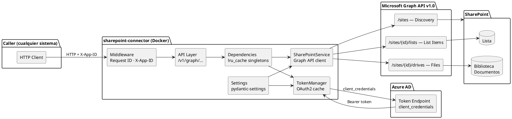
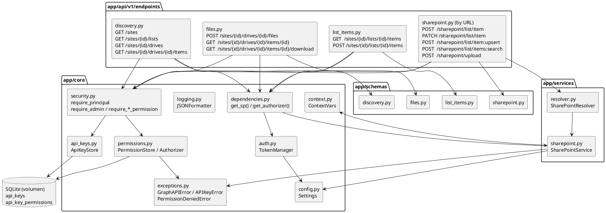
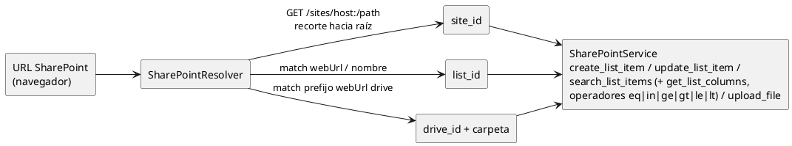
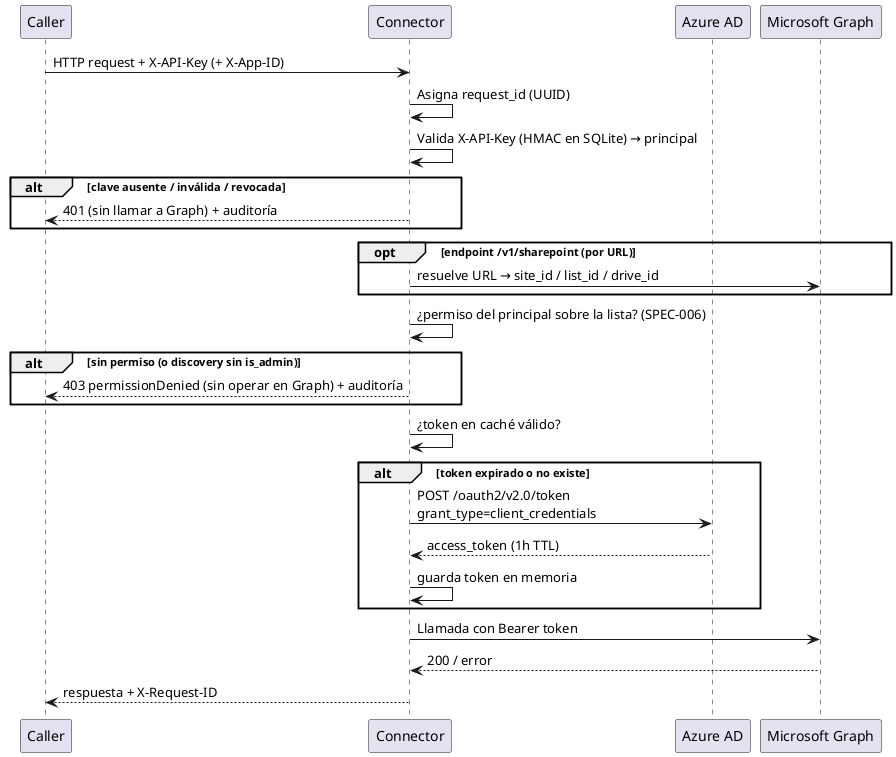
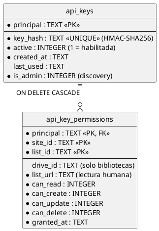

# Diagramas de Arquitectura (PlantUML): SharePoint Connector

**Versión:** 2.8.0
**Fecha:** 2026-09-03
**Autor:** Juan Camilo López Alzate — Latinia

> Versión en **PlantUML** de los diagramas de [`ARQUITECTURA.md`](ARQUITECTURA.md).
> Cada bloque puede renderizarse en [plantuml.com](https://www.plantuml.com/plantuml),
> con la extensión *PlantUML* de VS Code, o con el CLI `plantuml diagrama.puml`.

---

## 2. Arquitectura actual

---

## 3. Componentes internos

---

## 4. Capa de resolución de URL (`SharePointResolver`)

---

## 4.b Validación de un filtro de `items:search` (v2.6.0)

> Los diagramas anteriores no descienden al detalle de un filtro, así que ninguno
> quedó obsoleto al añadir los operadores. Este se añade porque la validación sí
> gana un paso propio —«¿admite esta columna este operador?»— y porque la
> frontera `422`/`400` es el núcleo de este endpoint: `422` es lo que puede
> juzgarse con el body a solas, `400` lo que exige conocer la lista. Ninguna
> condición se delega a Graph.

```plantuml
@startuml validacion-filtro-search
skinparam defaultTextAlignment center

start
:Body del request;

partition "422 — schema (Pydantic), sin resolver la lista" {
  if (¿campo desconocido en el body?) then (sí)
    :422 — extra="forbid";
    stop
  else (no)
  endif
  if (¿`field` fuera de [A-Za-z0-9_]+?) then (sí)
    :422;
    stop
  else (no)
  endif
  if (¿`op` fuera de {eq, in, ge, gt, le, lt}?) then (sí)
    :422 — enum cerrado;
    stop
  else (no)
  endif
  if (¿la forma de `value` discrepa de `op`?) then (sí)
    :422 — `in` exige array,\nel resto un escalar;
    stop
  else (no)
  endif
  if (¿array de `in` vacío, >20\no de tipos mezclados?) then (sí)
    :422;
    stop
  else (no)
  endif
  if (¿>100 cláusulas tras expandir los `in`?) then (sí)
    :422 — indica el número generado\ny el límite;
    stop
  else (no)
  endif
}

:Resolver la URL → site_id + list_id;
:get_list_columns(site_id, list_id)\ncaché por (site_id, list_id), TTL 300 s\n(la validación de operadores no añade llamadas);

partition "400 — servicio, contra el esquema real de columnas" {
  :Revalidar `field` y `op`\n(defensa en profundidad);
  if (¿existe la columna?) then (no)
    :400 — nombra el campo;
    stop
  else (sí)
  endif
  if (¿lookup por su nombre base?) then (sí)
    :400 — debe usarse {Columna}LookupId;
    stop
  else (no)
  endif
  if (¿el tipo de la columna admite el `op`?) then (no)
    :400 — nombra columna, tipo y\noperadores válidos;
    stop
  else (sí)
  endif
  if (¿el tipo JSON corresponde al de la columna,\nen CADA elemento de un `in`?) then (no)
    :400 — un elemento malo\nrechaza el filtro entero;
    stop
  else (sí)
  endif
  if (¿columna de fecha con valor\nno parseable como ISO-8601?) then (sí)
    :400 — nombra la columna\ny el formato esperado;
    stop
  else (no)
  endif
}

:Construir la cláusula\neq/ge/gt/le/lt → fields/X op literal\nin → (fields/X eq a or fields/X eq b);
:Unir las cláusulas con " and " y percent-encodear\nla expresión completa como una sola unidad;
:GET .../items?$filter=...\nPrefer: HonorNonIndexedQueriesWarningMayFailRandomly;
stop
@enduml
```

---

## 5. Autenticación y seguridad

---

## 6. Modelo de datos de claves y permisos (SPEC-005 / SPEC-006)

